# 🅿️ ParkProof

[](https://github.com/melroyds/parkproof/actions/workflows/test.yml)
[](LICENSE)

> Photograph any Australian parking sign → get a plain-English answer to **"Can I park here right now?"**, plus a signed record of where and when you parked, in case a fine arrives later.

A mobile-first, installable PWA with end-to-end AI: sign reading, a signed record of each park, reminders, a notice lookup for when a fine arrives, and evidence PDFs anyone can check with `openssl`, all on a real AWS backend.

> **What this demonstrates (it's a PM portfolio piece).** Solo-built and shipped: a mobile PWA, AI vision with schema-enforced output and adaptive thinking, a single-Lambda AWS backend with an async-polling pattern around the API Gateway 30 s ceiling, a KMS-signed chain of evidence with an `openssl`-checkable PDF, nine census-chosen languages, a legal-safety discipline (every claim about a signature says what it doesn't show), and a feature built and then deliberately left switched off until a lawyer has read it. The product decisions, trade-offs, the not-built list and the honest limitations are in **[the case study →](docs/case-study.md)**. This README is the feature and architecture reference.

> **🚀 Try it live:** [https://www.parkproof.com.au](https://www.parkproof.com.au)
>
> Best on a phone: tap your browser's share menu → **"Add to Home Screen"** and ParkProof installs like an app (own icon, full screen). On iPhone, reminders that arrive while ParkProof is closed need it on the Home Screen. Desktop works too, with photos from your library.

> **Status (9 Nov 2026).** The live site runs `main`. The features marked *(roadmap 2)* below are built and tested on `integration/roadmap-2` and not deployed yet; [`docs/build/deploy-checklist-roadmap-2.md`](docs/build/deploy-checklist-roadmap-2.md) is the runbook. Workday mode is built but stays off in production until a lawyer has read its copy.

---

## Demo

> The screenshots below are from 25 May 2026, before the green "vault" redesign and before roadmap 2. They'll be regenerated (`npm run screenshots`) once the next design direction is chosen.

**Landing.** What a first-time visitor sees: the headline, three value points, the scan button and a "How it works" strip.

<p align="center">
  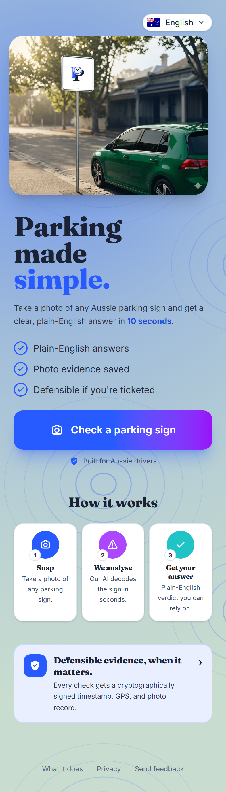
</p>

**Live countdown.** While you're parked, home shows the countdown: how long is left, a walk back to the car, and "I've left".

<p align="center">
  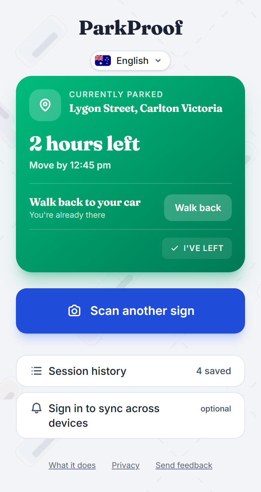
</p>

### Core flow

| 1. Scan | 2. Clarify (when needed) | 3. Result |
|---|---|---|
| 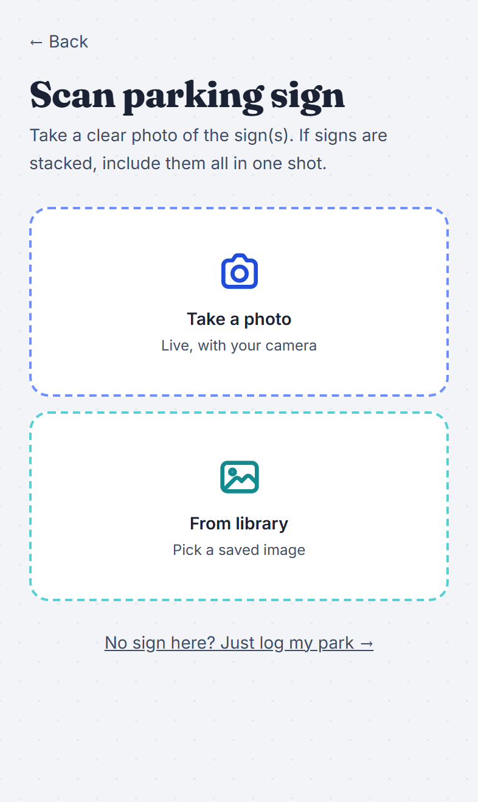 | 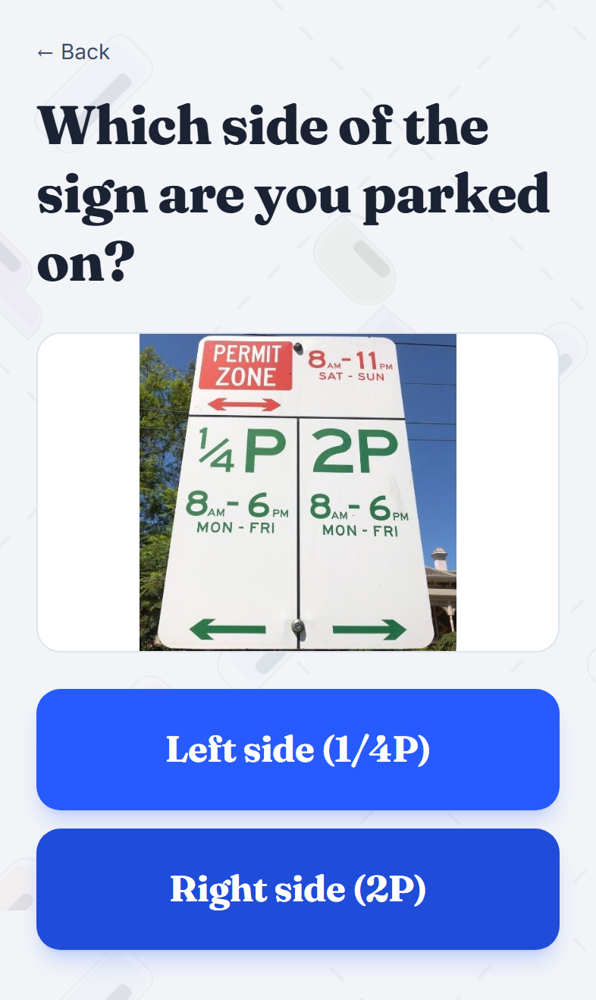 | 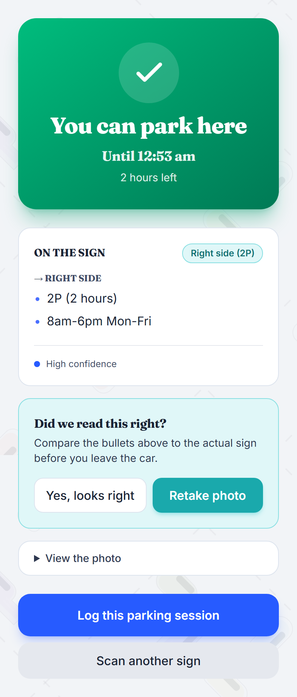 |

| 4. Log the park | 5. Reminder | 6. History |
|---|---|---|
| 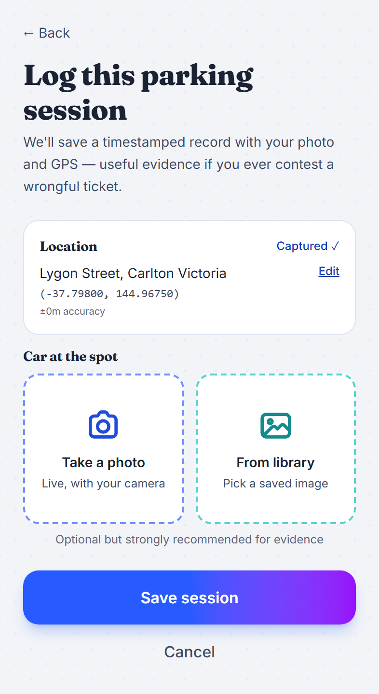 | 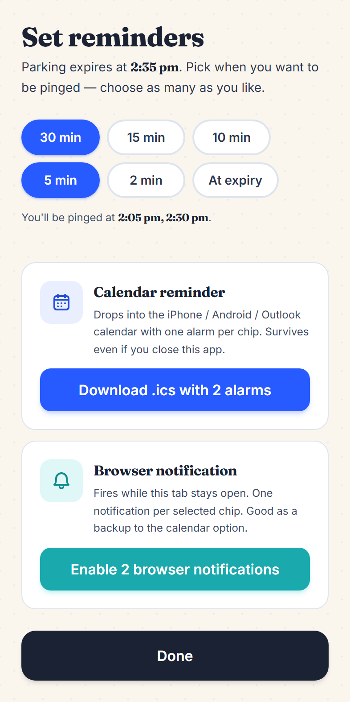 | 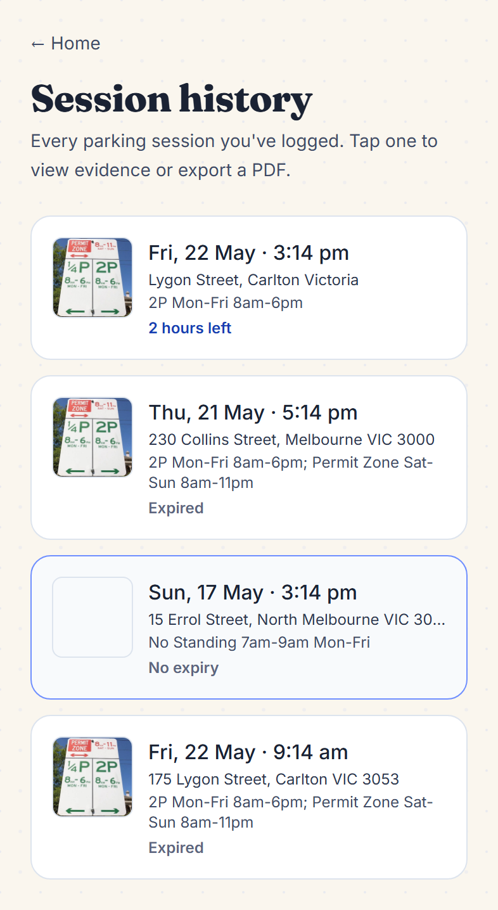 |

| 7. The record · PDF export · signature pages |
|---|
| 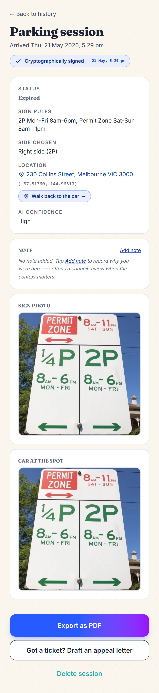 |

### Smart features

| Photo-quality warning | Re-check card |
|---|---|
| 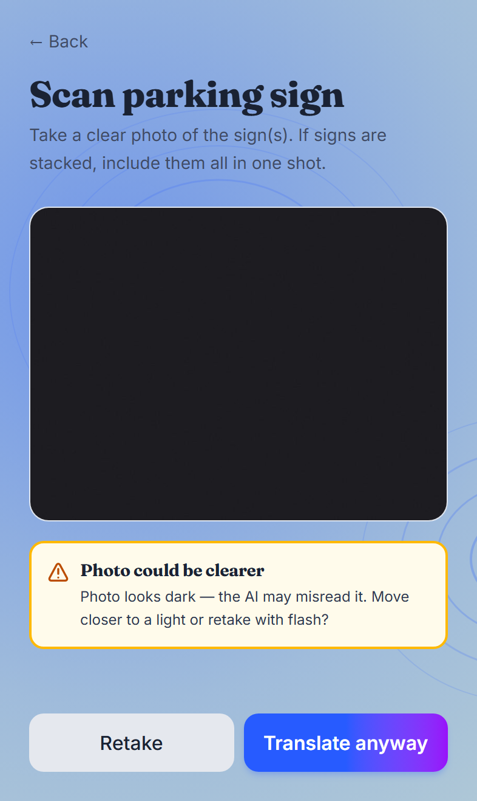 | 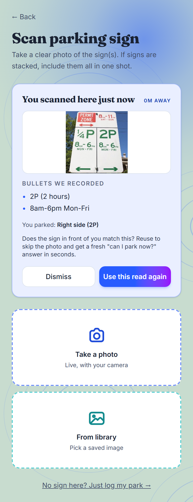 |

| AI-drafted appeal letter |
|---|
| 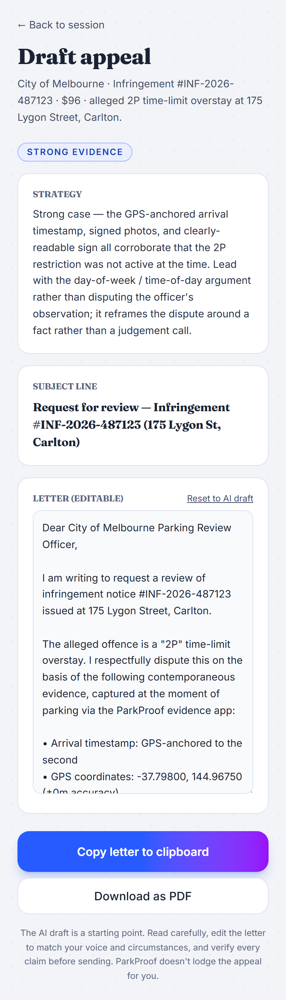 |

### Sign-in and cloud sync (optional)

| Sign in (Apple / Google / email) | Account |
|---|---|
| 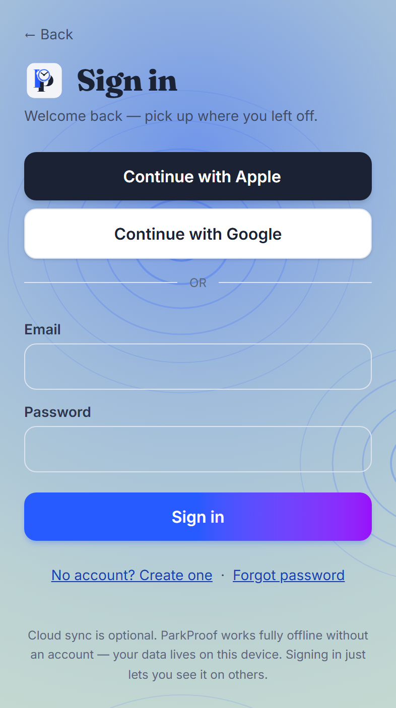 | 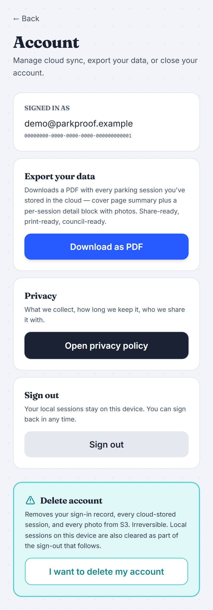 |

### Nine languages

| 🇦🇺 English | 🇮🇹 Italiano | 🇮🇳 हिन्दी |
|---|---|---|
| 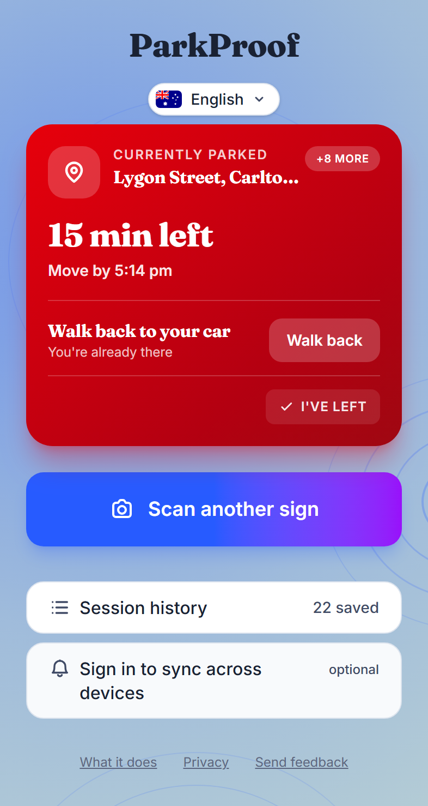 | 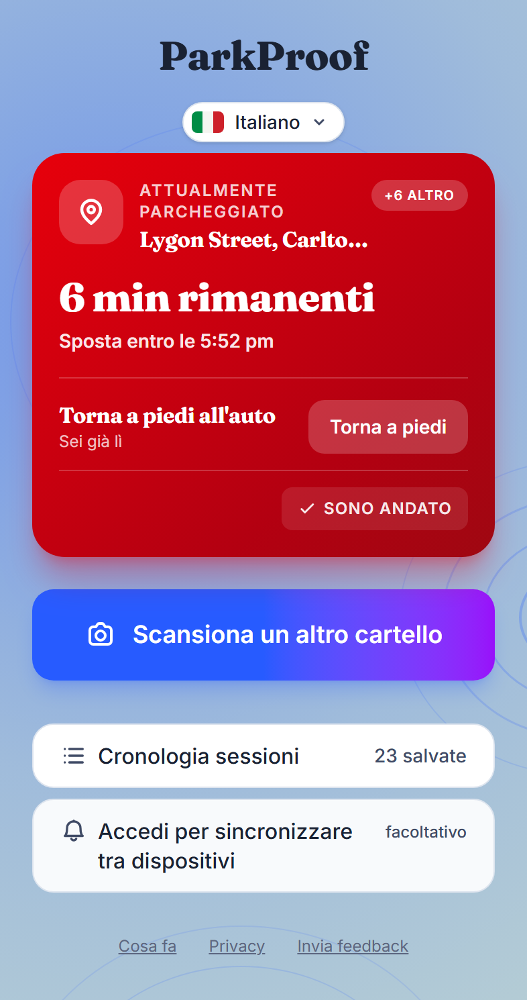 | 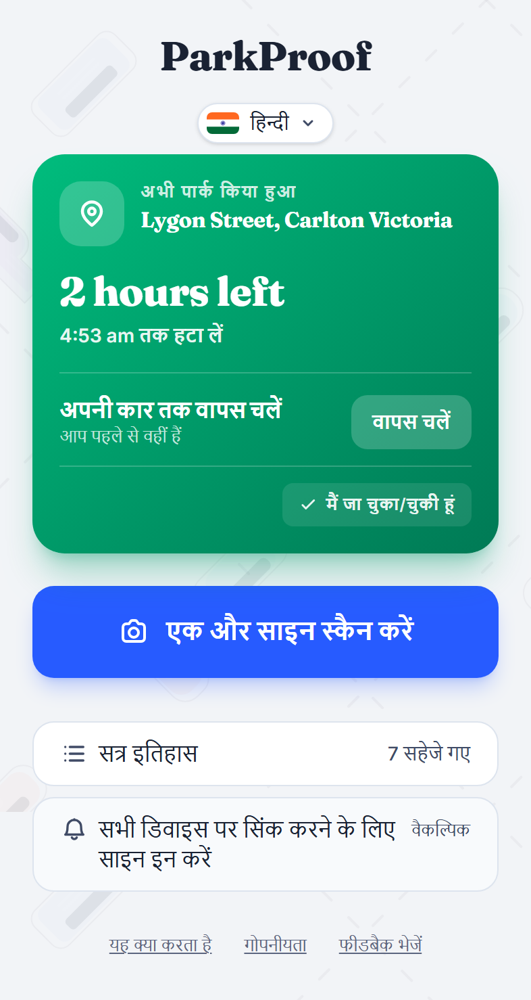 |

> _The screenshots come from `npm run screenshots`: a Playwright harness in [`scripts/screenshots.mjs`](scripts/screenshots.mjs) drives the real app on an iPhone 15 Pro viewport with mocked Anthropic and AWS calls, so the run is hermetic and offline._

---

## How to use it

1. **Scan the sign.** Tap **Scan a parking sign** and photograph the sign where you parked. A few seconds later you get **can I park here now** and, when there's a limit, the time to leave by. If the sign has arrows or sides, ParkProof asks where you are first. Always glance at the real sign too: it's an AI read.
2. **Save the park** *(optional)*. **Save & remind me** records the time, your phone's GPS, the address (editable) and, if you like, a photo of the car. Optional extras *(roadmap 2)*, collapsed by default: who's driving, photos of the car's condition, and a photo of your meter ticket or permit. ParkProof's server signs the record as soon as your phone is online.
3. **Get a reminder.** Pick when, tap **Remind me** *(roadmap 2)*. It arrives even with ParkProof closed when your phone allows that, and the screen says plainly when it can only remind you while ParkProof is open. **Download .ics** gives you a calendar file with the same alarms. Reminders can be delayed or silenced, for example by Focus or battery saving, so don't rely on them alone.
4. **Tap I've left** when you drive off. It records the time you tapped (your phone's clock) and where your phone was, and ParkProof signs it.
5. **Got a fine?** Home → **Got a fine? Start here** *(roadmap 2)*. Photograph the notice: ParkProof reads its date, time and place, finds your records from around then, and compares them, line by line, with what the notice says. From there you can export the evidence PDF or draft an appeal letter. It isn't legal advice, and it doesn't say whether the fine should stand.
6. **Check a record.** On any record, **Check signatures** checks every signed part and photo on your phone. The PDF's last pages and the [verify page](https://www.parkproof.com.au/verify/) show anyone how to check them with `openssl`. A valid signature shows the signed details haven't changed since ParkProof signed them. It doesn't show they're true, who was driving, where the car was, or when it arrived or left.

---

## What it does

### Reading the sign
1. **Sign reader.** Camera or library photo → Claude reads the sign → a plain-English answer, with the time to leave by, in the timezone of the spot.
2. **Photo-quality pre-check.** Blur and brightness checks run on the phone before any AI call, and warn rather than block.
3. **Clarify step.** When the rules depend on where you are (arrows, sides, bays), ParkProof asks first so the answer matches your spot.
4. **Rule-change heads-up.** A banner when a meaningful change is due within about 3 hours ("Permit Zone ends at 6 pm").
5. **Unclear signs** *(roadmap 2)*. The reader says whether it found a readable sign. A partly hidden or contradictory sign gets the most restrictive answer and a warning. No readable sign: ParkProof says so, reminds you that general road rules still apply where there's no sign, and lets you retake the photo or log the park without one.
6. **Area signs and weekly restrictions** *(roadmap 2)*. The reader flags signs that govern a whole area and picks out restrictions that come back on set days (street cleaning, clearways), so you can turn them into a weekly reminder.
7. **Paid parking and permits.** If the sign needs a ticket, a permit zone permit or an accessible parking permit, you confirm before you save; nothing is ticked for you. With permits saved in Settings *(roadmap 2)*, the answer shows what the sign itself prints for your permit, separately from the standard answer, and checks a permit zone's area against yours. ParkProof never works out a concession: when the sign prints nothing for your permit, it says the permit may allow more time under that state's rules, that ParkProof doesn't calculate that, and to check the permit's conditions. For an accessible permit it asks whether the permit holder is in the car and getting out there.
8. **Payment app links.** When the sign shows a pay-by-app sticker, the result links to that app (EasyPark, PayStay, OPark, Wilson Parking, Secure Parking).
9. **Re-check.** Back at a spot you scanned within 40 m and 7 days? Re-check the earlier reading against the current time, with no new photo. About 3× faster and 4× cheaper. Desktop and no-GPS users get a recent-scans picker.

### The record
10. **Parking record.** Time, GPS, editable address, car photo, and a 280-character note in your own words (notes aren't signed).
11. **Signed, part by part.** ParkProof's server signs each part of a record with an **AWS KMS ECDSA P-256** key when it receives it: the arrival, the details you gave when you parked, each photo you add later, the departure, a handover. Each part names the one before it, so the parts form a chain. Photos stay on your phone; only their fingerprints are signed.
12. **Condition photos and proof of payment** *(roadmap 2)*. Optional camera-only photos of the car's front, rear, sides and any damage, at parking and on return, and a photo of your meter ticket, payment confirmation or permit. A signed photo shows the photo existed by the time it was signed. It doesn't show who caused any damage.
13. **I've left.** The departure sheet records your tap (phone clock) and your phone's location, and ParkProof signs it. If your phone was far from where you parked, the record says so.
14. **No sign here.** Log a park where there's no sign, with a photo of the surroundings. It stays on home until you tap I've left.
15. **Evidence PDF.** Every record exports as a PDF: times labelled as phone or server times, address, GPS, the sign reading, photos with captions, and signature pages with step-by-step `openssl` checks for each part and photo. It says plainly what it is: a record of a parking event, not a legal finding.
16. **Evidence file** *(roadmap 2)*. A `.json` file with every signature and the original photos, so anyone can check the record without ParkProof. Permit details are left out unless you tick "Include permit details".
17. **Who's driving, sharing and handovers** *(roadmap 2)*. Add a driver's name (it's your statement, not checked). **Share where the car is** makes a link with the signed arrival and the sender's own notes, marked as unsigned; whoever opens it gets a read-only copy. **Hand the car over** records who took the car next, signed as your statement.
18. **History.** Every record, with its status and its signed parts.

### Reminders
19. **Remind me** *(roadmap 2; the live site has the older separate push and browser-notification buttons)*. One button: pick any of 30, 15, 10, 5, 2 or 0 minutes before the limit. It books a server-side **Web Push** through EventBridge Scheduler when your phone can receive one, and in-tab reminders otherwise, and says which. Booked times show on the record and on the home card, and I've left cancels them.
20. **Calendar file.** **Download .ics**: a calendar event with the same alarms, in your language.
21. **Street sweeping and weekly reminders** *(roadmap 2)*. Weekly, fortnightly or "first and third Tuesday" rules, set by hand or from a sign, with a reminder the evening before or a set time before. On the phone, in a calendar file with a repeat rule, and by weekly push. Councils change these schedules, so the app says to check the signs.

### When a fine arrives
22. **Got a fine? Start here** *(roadmap 2)*. Reads the notice's number, date, time, place, offence and due date; finds your records from around then; and compares them in plain statements: when you tapped I've left by your phone's clock, whether ParkProof signed that before the time on the notice, who the record says was driving. Always: check the registration on the notice, and check its due date.
23. **AI-drafted appeal letter.** Claude reads the notice and drafts a formal letter to the issuing council from your record. You edit it and export it as a PDF. It's a starting point, not legal advice, and it never claims more than the record shows.

### Settings, privacy and access
24. **Settings** *(roadmap 2)*. Your name for new records, up to 3 permits, and notifications. Saved in this browser only.
25. **Privacy policy in the app**, in plain English, saying what leaves your phone and how long anything is kept.
26. **Nine languages.** English, 简体中文, Tiếng Việt, Bahasa Indonesia, 한국어, Italiano, Ελληνικά, हिन्दी and ਪੰਜਾਬੀ, chosen from the top languages spoken at home in the City of Melbourne (2021 Census). The whole app and the PDFs translate; the AI's sign reading stays in English because it quotes the sign.
27. **No account needed.** Everything works without signing in. Sign in (email, Apple or Google) to back records up and see them on your other devices.
28. **Account export and delete.** One PDF of every record; or delete everything (database rows, photos, the account itself).

### Workday mode (built, off in production)
For drivers who move the car between time-limited spots all day: each stop gets its own record from a fresh photo of its sign, ParkProof asks whether you left the signed stretch when a new stop may be on the same one (moving a few bays doesn't restart a limit), keeps the original limit running when you're not sure, and books each stop's reminders. Victoria and Queensland only. It ships only after a lawyer has read every line of its copy (`docs/legal-review-queue.md`).

---

## The problem

Australian parking signs are dense, especially in inner Melbourne, Sydney and Brisbane: a pole can stack three or four signs with overlapping times, arrows, permit zones and pay bays. Other apps translate the rules. ParkProof also keeps a record of the park that anyone can check later, and helps when a notice arrives.

---

## Architecture

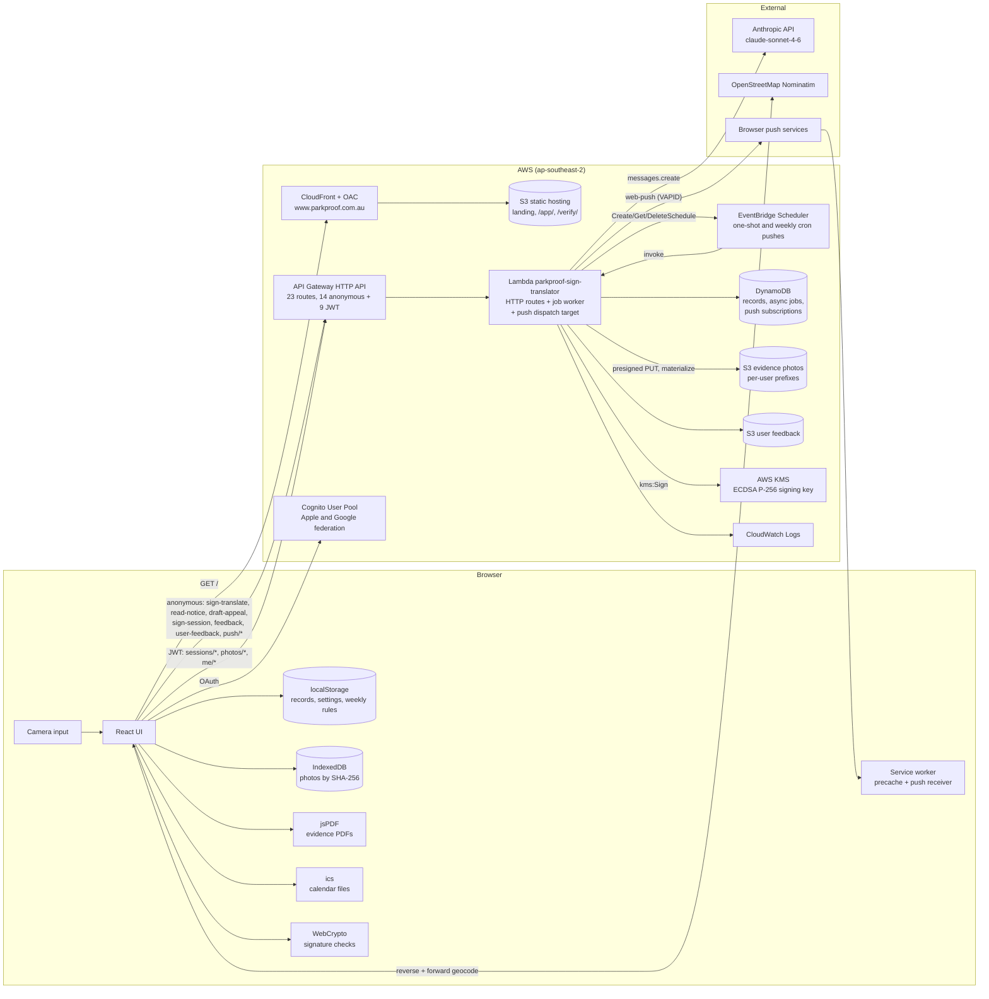

One Lambda handler ([`lambda/index.js`](lambda/index.js)) is also the **local dev proxy**: a Vite plugin in [`vite.config.ts`](vite.config.ts) imports it in-process, so what you debug locally is what runs in production. It answers 23 API Gateway routes once roadmap 2 is deployed: 14 anonymous (sign reading and its status poll, notice reading and its poll, appeal drafting and its poll, signing, two feedback routes, and five push routes) and 9 behind the Cognito JWT authorizer (cloud sync, photo upload and materialise, account export and delete). It is also the self-invoked worker for the slow AI jobs and the EventBridge Scheduler target for one-shot and weekly reminders. The full route table is in [`CLAUDE.md`](CLAUDE.md).

---

## Stack

| Layer | Choice | Why |
|---|---|---|
| UI | Vite + React 19 + TypeScript | Fast HMR, type safety |
| Styling | Tailwind CSS 4 (Vite plugin) | Utility classes keep the JSX legible |
| Brand | The Greenfield "vault": deep pine `#073B25`, white chamfered cards, a mint spark for the signed seal only; Space Grotesk + Inter | Reads like a document of record, not a game |
| AI | Claude Sonnet 4.6: adaptive thinking + `effort: low` for signs; no thinking for notices and letters | Multi-rule time maths needs thinking; transcription and drafting don't |
| Schema | `output_config.format: { json_schema }` | API-enforced JSON shape, with a size budget test and a live compile check |
| Backend | AWS Lambda, Node.js 22 (prod) / Vite middleware (dev) | Same handler in both |
| Signing | AWS KMS ECDSA P-256, a chain of signed parts | The private key never leaves AWS; anyone can check with `openssl` or the in-app verifier |
| Hosting | S3 (private) + CloudFront with Origin Access Control | HTTPS, CDN, no public bucket |
| Storage (on the phone) | `localStorage` for records and settings, IndexedDB for photos | Local first; photos are content-addressed and immutable |
| Geocoding | OpenStreetMap Nominatim | Free, no key |
| Timezone | [`tz-lookup`](https://www.npmjs.com/package/tz-lookup) | lat/lng → IANA zone, offline |
| Calendar | [`ics`](https://www.npmjs.com/package/ics) | Multi-alarm events and weekly repeat rules; lazy-loaded |
| PDF | [`jsPDF`](https://www.npmjs.com/package/jspdf) + [`jspdf-autotable`](https://www.npmjs.com/package/jspdf-autotable) | Evidence and appeal PDFs with per-locale Noto font subsets; lazy-loaded |
| PWA | [`vite-plugin-pwa`](https://www.npmjs.com/package/vite-plugin-pwa) (injectManifest) | Custom service worker for push |
| i18n | [`react-i18next`](https://react.i18next.com/) | 9 locales, bundled inline (so switching is instant) |
| Auth (optional) | Cognito + [`amazon-cognito-identity-js`](https://www.npmjs.com/package/amazon-cognito-identity-js) | Email, Google and Apple; no Amplify |
| Cloud sync (optional) | DynamoDB + S3 | A mirror with a merge that never drops a signed part; the phone stays the source of truth |
| Push | Web Push (VAPID) + EventBridge Scheduler | Reminders that arrive with the app closed, owned by the device that booked them |
| Telemetry | CloudWatch Logs Insights | Structured log lines, no analytics SDK |

---

## Notable engineering decisions

- **One handler, two runtimes.** The Lambda and the local dev proxy run the same code.
- **API-enforced JSON, not prompted JSON.** The answer's shape is a JSON Schema passed in `output_config.format`, including per-position answers for arrow signs.
- **A grammar budget for that schema.** The API compiles the schema into a grammar and refused T3's first version as too large, which only a real call could show, and the limit is tighter with adaptive thinking on. The model's raw shape is flattened, a normaliser maps it back, a test caps its size, and `scripts/check-schema-compiles.mjs` sends one tiny real request per schema before every deploy.
- **Adaptive thinking + `effort: low`.** Haiku 4.5 (no thinking) got stacked signs wrong, so the sign reader stays on Sonnet 4.6 with `effort` lowered to keep scans in the 6 to 12 s range.
- **A chain of signed parts, not one signature.** Each later fact (a photo, the departure, a handover) is its own signed part naming the hash of the one before, so a record can grow after it was first signed without anything being re-signed. The server refuses malformed parts rather than repairing them, refuses phone times from the future, and every screen shows signed values from the signed payload.
- **Honest copy as a feature.** Phone times say "phone clock", only ParkProof's signing time is called signed, driver statements are the driver's own, and every place a signature is shown says what it doesn't prove. A copy lint fails the build on em-dashes in all 9 languages, and on banned claims in the English strings, JSX text and error messages. It doesn't check the translations' wording: that is left to the language reviews.
- **Health information stays out of signatures.** An accessible parking permit is signed only as a salted hash; the details leave the phone only if the driver ticks a box.
- **Async polling for slow AI calls.** Stacked signs can take 30 to 50 s, past API Gateway's 30 s limit. The slow routes write a job row, self-invoke the Lambda and return `202 { job_id }`; the client polls. Notice reads delete their row as soon as the phone has them.
- **Push owned by a device, named deterministically.** One-shot reminders are `parkproof-push-{record}-{i}` and weekly ones `parkproof-push-r-{rule}-{0|1}` (cron in the rule's own time zone, deleting themselves after 90 days). Only the device that booked a schedule can change it, and no `ListSchedules` permission is needed.
- **Self-healing push registration.** The phone re-sends its registration on open and before every booking; the server refuses to book for a device it doesn't know, and remembers dead endpoints so they can't come back.
- **Anonymous by default, opt-in cloud.** No login wall. The cloud is a mirror, merged both ways without losing a signed part.
- **A feature behind a legal gate.** Workday mode is built and tested but off in production builds; the deploy scripts set the flag explicitly so no `.env` line can turn it on.

---

## Running locally

```bash
npm install
(cd lambda && npm ci)                          # the dev proxy imports the AWS SDK from lambda/
echo "ANTHROPIC_API_KEY=sk-ant-..." > .env
npm run dev                                    # → http://localhost:5173/app/
```

You need a Claude API key from <https://console.anthropic.com/settings/keys>. Localhost is a secure context, so geolocation, notifications and the camera input work without HTTPS. In dev, signing uses a throwaway key (records show "Signed with a development key"), and workday mode is on.

Tests: `npx vitest run` (168 files, 3,037 tests on 9 Nov 2026). Type check: `npx tsc -b`.

> **Windows with [vestauth](https://www.vestauth.com/):** it wraps `dotenv` and stops it filling `process.env`. `vite.config.ts` assigns the values itself; leave that block alone. If the project lives in Dropbox or OneDrive, run the dev server from a copy outside it: their file locks can break Vite's cache.

---

## Deploying

Idempotent scripts in [`scripts/`](scripts/). Follow [`docs/build/deploy-checklist-roadmap-2.md`](docs/build/deploy-checklist-roadmap-2.md) for the roadmap 2 deploy.

| Script | What it does | When |
|---|---|---|
| [`deploy.sh`](scripts/deploy.sh) | Packages the Lambda in a temp folder, moves it to Node 22, updates code and env, makes sure every route exists, re-cuts the PDF fonts, builds the frontend (workday mode off unless `DEPLOY_ALLOW_WORKDAY=1`), adds the landing, syncs to S3, invalidates CloudFront. `--package-only` rehearses the package with no AWS call | Every release |
| [`check-schema-compiles.mjs`](scripts/check-schema-compiles.mjs) | One tiny real Anthropic call per schema | Before every deploy |
| [`harden.sh`](scripts/harden.sh) | CORS lockdown, Origin Access Control, private S3 origin | Once |
| [`setup-signing.sh`](scripts/setup-signing.sh) | The KMS signing key and `public/parkproof-public-key.pem` | Once |
| [`setup-auth.sh`](scripts/setup-auth.sh) | Cognito, the records table, the evidence bucket, the JWT authorizer | Once (never for an IAM fix: it resets sign-in providers) |
| [`setup-feedback-bucket.sh`](scripts/setup-feedback-bucket.sh) | The feedback bucket (2-year expiry) | Once |
| [`setup-push.sh`](scripts/setup-push.sh) | VAPID keys and the push subscriptions table | Once |
| [`setup-push-scheduler.sh`](scripts/setup-push-scheduler.sh) | The Scheduler role and the Lambda's Scheduler permissions | Once |
| [`setup-jobs-table.sh`](scripts/setup-jobs-table.sh) | Lets the Lambda delete notice job rows | Once, before the roadmap 2 deploy |
| [`setup-log-retention.sh`](scripts/setup-log-retention.sh) | 90-day log retention, as the privacy policy says | Once, before the roadmap 2 deploy |
| [`set-throttle.sh`](scripts/set-throttle.sh), [`billing-alarm.sh`](scripts/billing-alarm.sh), [`anthropic-usage-alarm.sh`](scripts/anthropic-usage-alarm.sh) | Rate limits, the AWS budget alarm, the Claude call-volume alarm | Once; re-run to retune |
| [`smoke-test-auth.mjs`](scripts/smoke-test-auth.mjs), [`send-test-push.mjs`](scripts/send-test-push.mjs) | Live checks of the auth routes and of one push | After auth or push changes |
| [`eval-accuracy.mjs`](scripts/eval-accuracy.mjs) | The accuracy benchmark ([`eval/README.md`](eval/README.md)) | When the labelled set grows |
| [`screenshots.mjs`](scripts/screenshots.mjs) | Regenerates the demo screenshots | After visual changes |
| [`teardown.sh`](scripts/teardown.sh) | Removes what `deploy.sh` created (dry run by default). Leaves Cognito, tables, buckets, KMS and the scheduler | Only when walking away |

Stack: AWS Lambda (Node.js 22) + API Gateway HTTP API + DynamoDB + S3 + CloudFront + KMS + EventBridge Scheduler, in `ap-southeast-2` (Sydney).

**Prereqs:** the AWS CLI with suitable credentials, `node`, and PowerShell (Windows) or `zip` on PATH. Deploy from a clone outside Dropbox or OneDrive.

---

## Optional cloud sync

ParkProof works fully without signing in: open the app, scan a sign, log a park, set a reminder. Everything stays on the phone.

Sign in (email and password, or Apple or Google through the Cognito Hosted UI; see [`docs/federation-setup.md`](docs/federation-setup.md)) and records mirror to DynamoDB and photos to a private per-user S3 prefix, merged both ways so a signed part is never lost. Settings (your name and permits) stay in the browser and are never synced. Account management is in the app: export every record as a PDF, or delete the account and everything in it.

## What's not built yet

- **The About page and landing for roadmap 2.** Waiting for the redesign choice.
- **Accuracy numbers.** The harness and method page exist ([`eval/README.md`](eval/README.md), `/accuracy/`); the labelled test set doesn't yet, so there are no numbers to publish.
- **A legal read.** No lawyer is engaged. Workday mode stays off until one has read its copy; [`docs/legal-review-queue.md`](docs/legal-review-queue.md) lists every string they should read.
- **Citywide parking map.** Every scan has the data, but a map needs an opt-in share toggle, a viewer and enough scans to be useful.
- **Auto-submitting appeals.** Blocked by council captchas, logins and the lack of public APIs.
- **AI feedback Layer 3.** Opt-in photo capture for systematic failures, once Layer 2 points at one worth it.
- **Voice confirmation.** Considered and deferred: the phone is already in your hand at the sign.

---

## Files

```
ParkProof/
├── src/
│   ├── App.tsx                ← the view state machine and home
│   ├── types.ts               ← records, the signed chain, stores, notice fields
│   ├── index.css              ← Tailwind v4 @theme tokens, the vault background, .gf-card
│   ├── service-worker.ts      ← precache, push receiver, notification click
│   ├── components/            ← screens and sheets (scan, result, logger, record, history, notice,
│   │                            appeal, weekly reminders, settings, sharing, workday) and ui/
│   ├── locales/               ← 9 languages, generated by scripts/_i18n_inject_*.mjs
│   └── lib/                   ← storage, signing queue, verifier, photo store, sync and merge,
│                                API client, permits, notice matching, weekly rules, push, PDFs
├── lambda/
│   ├── index.js               ← the dispatcher and every anonymous route, the job worker, push dispatch
│   ├── sign-reading.js        ← the sign answer normaliser and request checks
│   ├── addendum-schema.js     ← signed-part schemas, shared with the browser
│   ├── recurring-schedule.js  ← weekly cron plans and their dispatch rules
│   └── cloud-sync.js          ← the JWT routes and the server merge
├── public/                    ← icons, splash, og-image, parkproof-public-key.pem, fonts/ (PDF subsets)
├── migrations/two-app-architecture/landing-from-claude-design/   ← landing, /verify/, /accuracy/
├── eval/                      ← the accuracy benchmark's corpus and rubric
├── docs/
│   ├── build/                 ← roadmap spec, deploy checklist, field-test plan, fix list
│   ├── legal-review-queue.md  ← every string a lawyer should read
│   ├── features.md            ← the feature showcase
│   ├── case-study.md          ← the PM narrative
│   └── screenshots/           ← README images
├── scripts/                   ← deploy and setup scripts, i18n injectors, schema check, eval harness
├── vite.config.ts             ← the dev /api proxy, the dev signer, the PWA plugin
├── CLAUDE.md                  ← engineering notes (routes, data model, gotchas)
└── README.md                  ← this file
```

---

## Further reading

- [`docs/features.md`](docs/features.md): the feature showcase, grouped, with copy-ready bullets
- [`docs/case-study.md`](docs/case-study.md): how the project was scoped, sequenced and traded off
- [`docs/build/roadmap-build-spec.md`](docs/build/roadmap-build-spec.md): roadmap 2, task by task, with its copy and legal rules
- [`docs/parkproof-build-journal.pdf`](docs/parkproof-build-journal.pdf): the build journal of the first two weeks
- [`docs/how-parkproof-was-built.pdf`](docs/how-parkproof-was-built.pdf): an ELI15 explainer of the stack
- [`docs/lessons-for-next-project.md`](docs/lessons-for-next-project.md): portable takeaways

## Support

ParkProof is free: no ads, no upsells, and no account needed. If it helped and you'd like to chip in for the AWS bill, there's a tip jar:

[☕ Buy me a coffee](https://buymeacoffee.com/parkproof)

Entirely optional. The app works the same whether you tip or not.

## Credits

Built with [Claude Code](https://claude.com/claude-code).
